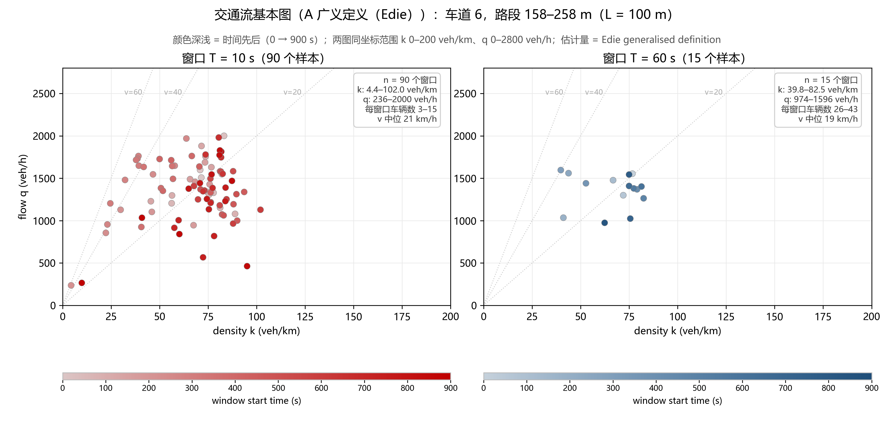
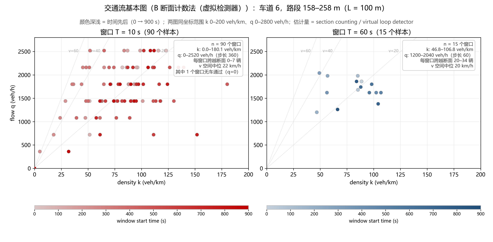

# week04 作业 —— 用车辆轨迹绘制交通流基本图

**数据**：NGSIM I-80（美国加州 Emeryville，I-80 东向），2005-04-13 16:00–16:15。
课程 SI 版 `NGSIM_I80_20050413_1600-1615_SI.csv`（米、秒），1,226,650 行、2,052 辆车、99.3 MB。

## 1. 分析范围

| 项 | 取值 |
|---|---|
| 方向 | I-80 东向（该文件即单一方向） |
| 车道 | **`lane_id = 6`**（7 条车道中最外侧的主线车道） |
| 路段 | **`local_y_m` ∈ [158, 258) m，L = 100 m** |
| 时间 | 全部 15 分钟（`time_s` 0–900 s） |

**统一单位与数据检查**：SI 版已为米/秒（`local_x_m`/`local_y_m`/`speed_m_s`），无需再换算。
缺失值 **0**；整行重复 **0**；`(vehicle_id, frame_id)` 重复 **0**；9,000 个时间戳、步长恒为 **0.100 s**。

**所选车道在所选路段的覆盖情况**：车道 6 共 222,067 条记录、529 辆车，纵向跨度 3.27–535.21 m
（几乎贯穿整个观测路段，故车辆会真正驶入/驶出），该车道中位车速 7.28 m/s。
在 1 m 分箱上滑动搜索全部 100 m 窗口，`[158, 258)` 是车道 6 覆盖最好的一个：
60,514 个车辆帧、448 辆车至少有一帧落在其中（占该车道记录的 27.3%）。

## 2. 计算口径（可复算）

采用 **Edie 广义定义**：

```
k = Σ t_i / (L · T)      q = Σ d_i / (L · T)      v = q / k
```

`t_i` 为第 i 辆车在窗口内的**停留时间**，`d_i` 为其在窗口内的**纵向行驶距离**，两者都只计入窗口内。

离散实现（10 Hz 网格）：把每辆车按 `time_s` 排序，相邻两帧组成一个区间；
**仅当两帧都在车道 6、且都在 [158, 258) 内**时该区间才计入，贡献 `Δt = t_右 − t_左` 与 `Δy = y_右 − y_左`。
这样车辆驶入/驶出路段或换道的那个区间被自然丢弃（每处最多截断 0.1 s）。区间跨窗口边界时按时间比例拆分。

实测自检：两套窗口计入的区间数**完全一致**（各 60,055 个）；跨窗口边界需拆分的 **0** 个；
`Δy < 0` 的噪声区间 **0** 个。

**「多种方法」体现在两个维度**，各出一张图：

| 维度 | 做法 | 图 |
|---|---|---|
| 窗口长度 | T = 10 s（90 个样本）与 T = 60 s（15 个样本），其余口径完全相同 | `fd_10s_vs_60s.png` |
| 估计量 | A Edie 广义定义（用 100 m 路段）／ B 断面计数法（虚拟检测器，只用一条断面） | `fd_detector_10s_vs_60s.png` |

**B 的口径**：在路段中点 y = 208 m 设一条虚拟断面，统计车辆跨越该断面的次数 `N_cross`，
则 `q = N_cross / T`；`v_s` 取跨越车辆速度的**调和平均**（空间平均速度）；`k = q / v_s`。
它只用到「一条断面 + 速度」，与路段长度 L 无关。

## 3. 窗口与样本数

| 窗口 T | 窗口数 | k (veh/km) 中位 [IQR] / 范围 | q (veh/h) 中位 [IQR] / 范围 | 每窗口车辆数 | v 中位 |
|---|---|---|---|---|---|
| **10 s** | **90** | 72.8 [56.4–81.2] / **4.4–102.0** | 1373 [1159–1622] / **236–2000** | 3–15（中位 12） | 20.9 km/h |
| **60 s** | **15** | 75.0 [57.6–77.0] / 39.8–82.5 | 1402 [1281–1510] / 974–1596 | 26–43（中位 37） | 18.8 km/h |

## 4. 结果图

### 方法 A：Edie 广义定义（主口径）



两幅图**坐标范围完全相同**（k: 0–200 veh/km，q: 0–2800 veh/h）；灰虚线为等速线 `v = q/k`。
**点的颜色深浅代表时间先后**（浅 = 窗口开始得早，深 = 晚），每个面板下配一条对应的色标。
这里不再使用按时间顺序连线 —— 连线会把 90 个点串成一条毛线球，反而看不清时间走向；
改成颜色编码后，时间维度既不占视觉通道（形状/位置），也保留在每个点上。

### 方法 B：断面计数法（虚拟检测器）



与 A **共用同一坐标范围**，可直接并排比较。

## 5. 图形差异解释

窗口从 10 s 放到 60 s，点云从「一大片松散、且两端有明显离群点」收拢成「一小团紧密的点」：
10 s 覆盖 k 约 4–102 veh/km、q 约 236–2000 veh/h，而 60 s 只覆盖 k 约 40–83、q 约 974–1596。

**原因在样本量**：100 m 路段在 10 s 窗口内平均只有 12 辆车（最少 3 辆），一辆车进出就足以让 k 变动
约 10 veh/km 的量级，因此 k、q 被离散抽样噪声主导；60 s 窗口平均有 37 辆车，单车的权重降到约
三十分之一，噪声被平掉。这与「k 的 IQR 差异其实不大（宽度 24.8 vs 19.4），差别主要出在尾部离群点」
一致——短窗口放大的主要是**极端窗口**，例如 k = 4.4 veh/km 那个窗口全窗累计停留时间只有 4.4 s
（不到一辆车待满整窗），而 k = 102 veh/km 的窗口已接近拥堵状态。

**但短窗口并没有系统性偏差**：两种窗口的 k 中位数（72.8 vs 75.0）和 q 中位数（1373 vs 1402）几乎相同，
说明 10 s 点云是围绕 60 s 点云散布的，增加的是方差而不是偏移。k 的标准差从 14.6 升到 19.8，
其中约一半来自高频噪声：在同一时间尺度（60 s 滞后）上看自相关，10 s 序列降到 0.43，
而 60 s 序列是 0.71 —— 那部分快速抖动在 60 s 尺度上已经自我衰减掉了。
颜色深浅还把剩下那条慢漂移显了出来：k 与时间的相关系数为 +0.24（10 s）/ +0.33（60 s），
q 与时间为 −0.20 / −0.35，即这 15 分钟里密度在缓慢升高、流量在缓慢下降，
速度最慢的 20% 窗口集中在 480–840 s。所以 60 s 的点也是沿一条状态轨迹移动，
而不是围绕一个固定平衡点。

## 6. 两种估计量的差异（A 与 B）

并排看两张图，B 的点云整体比 A 更靠右上。全时段平均流量：A 为 1355 veh/h，B 为 1684 veh/h，
**B/A = 1.243**。

**这个缺口可以精确追到一个几何量**。车道 6 里车辆往往只走 80 m 左右就被换道截断：448 个「在场片段」
的纵向长度中位 98.1 m、均值仅 76.3 m，其中 46% 从路段内部换道驶入、15% 从内部驶出。于是
`Σd / N_cross = 33876.3 / 421 = 80.5 m`，而 `L = 100 m`，`100 / 80.5 = 1.243` —— 与 B/A **完全吻合**。
断面计数把每个穿越者都算作「一次完整通过」，Edie 只累计它真正在这条车道内走过的距离；
两者的缺口大小，正好量化了这条车道的**换道活跃程度**。这也意味着：在换道频繁的路段上，
用单断面线圈反推密度会系统性高估流量。

**B 在短窗口下还有一个额外弱点**：T = 10 s 时 q 只能取 360 veh/h 的整数倍
（图中点云呈明显的水平条带，90 个样本落在 8 个离散流量值上），并且有 1 个窗口整窗无车通过（q = 0）。
T = 60 s 时量化步长降到 60 veh/h，条带基本消失。A 用累计量（Σt、Σd）算，是连续量，没有这个问题。
所以**短窗口下断面计数法不宜直接使用**，至少需要 60 s 以上，或改用 A 这类累计口径。

## 7. 复算

```bash
# 依赖：pandas / numpy / matplotlib（课堂环境 social-lstm 已具备）
python analyze_fundamental_diagram.py
# 换分析范围只改这两个参数（例如车道 4 的 270–370 m）
python analyze_fundamental_diagram.py --lane 4 --y0 270 --y1 370
```

产出：`results/fd_10s_vs_60s.png`（方法 A 结果图）、
`results/fd_detector_10s_vs_60s.png`（方法 B 结果图）、
`results/fd_windows_{10s,60s}.csv`（A 的逐窗口 `sum_t` / `sum_d` / 车辆数 / k / q / v，可逐行核对）、
`results/fd_windows_detector_{10s,60s}.csv`（B 的逐窗口 `n_crossings` / k / q / v）、
`results/fd_summary.json`（数据检查、覆盖情况、两套口径、A 与 B 的总账对照）。

数据文件 99 MB 未纳入版本库；脚本默认读取
`E:\jiaotongjianmo\week04\第4周_NGSIM-I80_课堂数据\`，可用 `--csv` 指定其他路径。

## 8. 说明

- **数据来源**：课程提供的第 4 周课堂数据包，原始出处
  <https://data.transportation.gov/d/8ect-6jqj>（`source_and_checks.json` 记录了下载日期、
  逐分钟 API 查询与 SHA-256 校验）。全班统一使用该 SI 版 CSV。
- **AI 辅助内容**：本次分析脚本由 AI 辅助编写；AI 还协助完成了车道覆盖情况的自动选址
  （1 m 分箱滑动搜索最佳 100 m 窗口），以及方法 B（断面计数法）的实现与两图的绘制。
- **本人完成的检查**：
  - 核对 SI 版列名与单位，确认 `local_y_m` 为纵向、`local_x_m` 为横向；
  - 用各车道 `local_x` 中位数随 `lane_id` 单调递增，确认**车道 1 为最左（内侧）、车道 7 为最右（外侧）**，
    并据此判断车道 6 属最外侧主线车道、车道 7 为匝道/辅助车道；
  - 逐行核对窗口明细 CSV 与手算：例如 T = 60 s 首个窗口 `Σt = 460.1 s`、`Σd = 2589.5 m`，
    得 `k = 460.1/6000 = 76.68 veh/km`、`q = 2589.5/6000 × 3600 = 1553.7 veh/h`、`v = 20.3 km/h`，
    与脚本输出一致（T = 10 s、L = 100 m 时 `L·T = 1000`，k 的数值恰等于 `Σt`，便于心算复核）；
  - 确认两套窗口的计入区间数一致、跨窗拆分 0 个、`Δy < 0` 区间 0 个；
  - 复核 A/B 的总账：`B/A = 1.243` 与 `L / 平均穿越长度 = 100/80.5 = 1.243` 是否一致（一致）。
- **局限**：本分析只覆盖单一车道的一个 100 m 路段、单一 15 分钟时段，结论不能外推到其他车道或时段；
  窗口边界处每辆车最多截断 0.1 s，对 `Σt` 的影响在千分之一量级；
  方法 B 的空间平均速度用「跨越断面那辆车的瞬时速度的调和平均」近似，而严格的空间平均
  应当按通过断面的时间加权；未做任何平滑或插补，NGSIM 本身的测量误差不在本作业讨论范围内。
