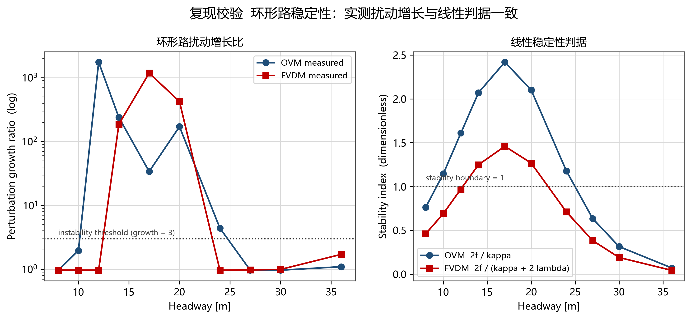
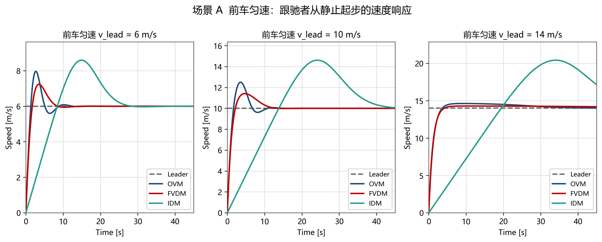
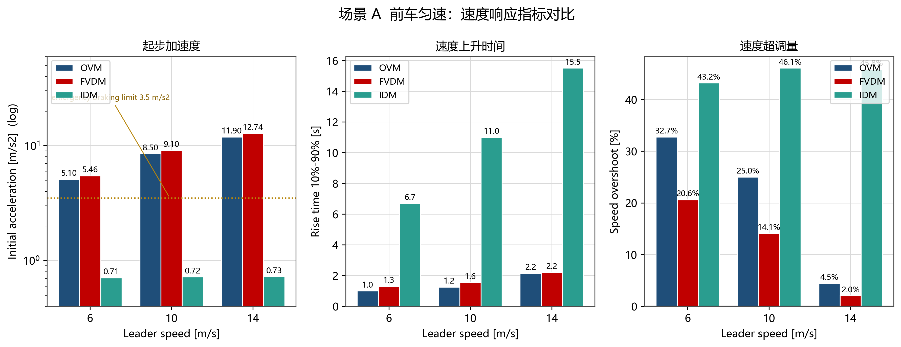
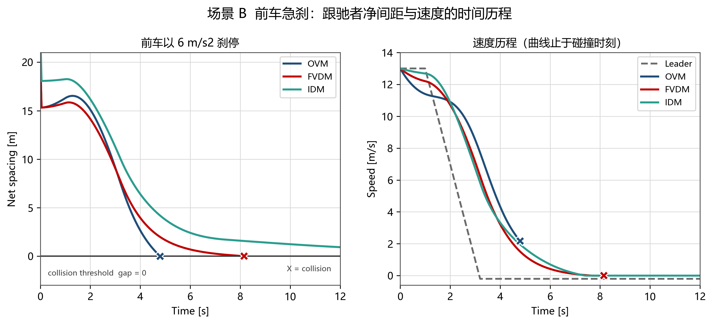
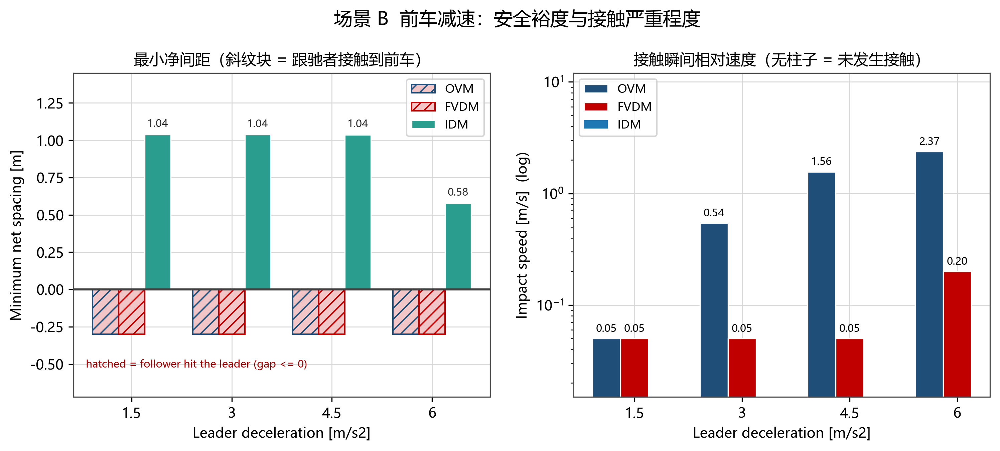
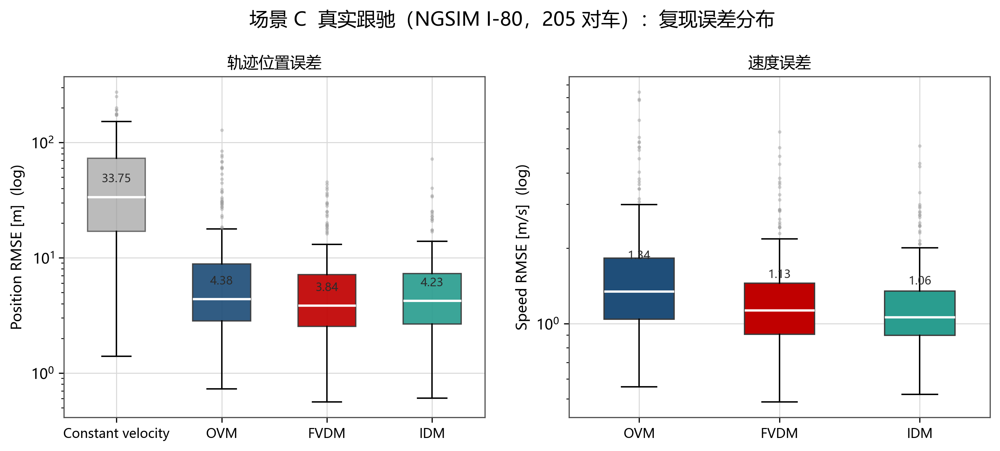
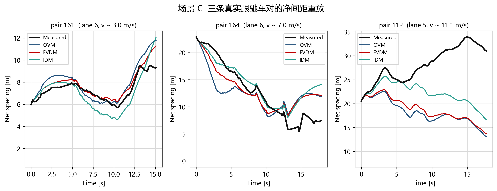

# week05 作业 —— 三种经典跟驰模型的复现与对比

**数据**：沿用上周（week04）的 NGSIM I-80 课堂数据
`NGSIM_I80_20050413_1600-1615_SI.csv`（美国加州 Emeryville，I-80 东向，2005-04-13 16:00–16:15）。
本次不再做基本图，而是**从中重建出真实的「前车—后车」跟驰车对**，用来检验三个模型的复现效果。

**原文**（三篇 PDF 已下载归档在 `papers/`，均从官方或作者主页取得免费版本）：

| 模型 | 文献 | 本地文件 |
|---|---|---|
| OVM | Bando, Hasebe, Nakayama, Shibata & Sugiyama, *Phys. Rev. E* **51**, 1035 (1995) | `papers/Bando1995_OVM_PRE51_1035.pdf` |
| FVDM | Jiang, Wu & Zhu, *Phys. Rev. E* **64**, 017101 (2001) | `papers/Jiang2001_FVDM_PRE64_017101.pdf` |
| IDM | Treiber, Hennecke & Helbing, *Phys. Rev. E* **62**, 1805 (2000) | `papers/Treiber2000_IDM_PRE62_1805.pdf` |

## 1. 复现的模型与参数

三个模型统一写成对**净间距**的加速度函数，参数一律取原文（或原文直接引用的标定）。

| 模型 | 动力学方程 | 参数 |
|---|---|---|
| OVM | `dv/dt = κ [ V(s) − v ]` | κ = 0.85 1/s |
| FVDM | `dv/dt = κ [ V(s) − v ] + λ (v_lead − v)` | κ = 0.41 1/s，λ = 0.5 1/s（s ≤ 100 m 时；原文说明仿真中车头间距不超过 100 m，故等价于常数） |
| IDM | `dv/dt = a [ 1 − (v/v0)^δ − (s*/s)² ]`，`s* = s0 + s1√(v/v0) + Tv + vΔv/(2√(ab))` | v0 = 33.33 m/s，T = 1.6 s，a = 0.73 m/s²，b = 1.67 m/s²，δ = 4，s0 = 2 m，s1 = 0，l = 5 m |

OVM 与 FVDM 共用最优速度函数

```
V(s) = 6.75 + 7.91 · tanh[ 0.13 (s − 5) − 1.57 ]   [m/s, s 为车头间距，单位 m]
```

参数出处需要说明一点：**Bando 1995 原文给出的 V(s) 是无量纲形式**（`V(Δx) = tanh(Δx − 2) + tanh(2)` 之类的形状函数），
上面这组带量纲的标定值出自 Helbing & Tilch (1998)，并被 Jiang (2001) 第 5 式原样沿用。
本作业取后者，因为它是文献里实际用于对比的那一版，也与 Jiang 表 I 的数值对得上。

## 2. 统一口径：净间距，而不是车头间距

**这是本次复现里最容易出错的地方，必须单独说明。**

OVM / FVDM 原文的 `s` 是**车头间距**（前车车头到本车车头，即质心距），IDM 原文的 `s` 是**净间距**
（前车车尾到本车车头，bumper-to-bumper）。两者差一个车长 `l = 5 m`：

```
s_车头间距 = gap_净间距 + 5 m
```

本实现把这一差异吸收在模型内部，对外只暴露净间距这一个接口 `accel(v_self, v_lead, gap_net)`，
因此三个模型可以放在同一套仿真器、同一份数据上跑，不会出现「给 OVM 传净间距、给 IDM 传车头间距」这类错位。
积分器统一用 Treiber 推荐的弹道格式 `x ← x + v·dt + ½a·dt²`、`v ← v + a·dt`（对匀加速精确）。

数据一侧同样要从坐标约定反推净间距：NGSIM 的 `local_y` 究竟是车头还是质心，直接决定间距怎么算。
这一点不靠猜，用数据自己判 —— 统计 `(y_lead − y_own) − L_lead` 的负值占比，车头约定下该量极少为负、
且与后车车长无关。本数据给出负值占比 0.278%，判定 **`local_y` 为车头位置**，
于是 `净间距 = (y_lead − y_own) − L_lead`。诊断记录见 `results/ngsim_pair_diagnostic.json`。

## 3. 复现正确性校验

复现不能只靠"跑出来像"，先做四组独立自检（脚本 `validate_models.py`，报告 `results/validation_report.txt`）。

| 检查 | 做法 | 结果 |
|---|---|---|
| V1 解析性质 | OV 函数零点、速度上限、反函数往返、稳态间距的闭式解与二分反解互校 | V = 0 落在净间距 2.3204 m（即车头间距 **7.3204 m**，与原文"7.4 m 车头间距时 V = 0"吻合）；速度上限 14.66 m/s = 52.78 km/h；稳态往返误差 ≤ 4.4×10⁻¹⁶ |
| V2 线性稳定性 | 环形路上给扰动，实测振幅增长比，与 Bando 判据 `f < κ/2` 和 Jiang 判据 `f < κ/2 + λ` 对照 | 判定一致率 **OVM 9/10、FVDM 10/10**；两模型的稳定区间宽度差异与判据一致 |
| V3 步长收敛 | 同一场景 `dt` 从 0.1 s 收到 0.005 s，比较末位置 | `dt ≤ 0.05 s` 时偏差 ≤ 6.2×10⁻¹¹ m，远小于轨迹级（米）误差，故后续统一取 0.05 s |
| V4 复现 Jiang(2001) 表 I | 11 辆车以 7.4 m 车头间距静止排队，绿灯起动，测起动延迟 dt 与阻塞波速 c_j | OVM **1.622 s / 16.4 km/h**（原文 1.60 s / 16.65 km/h）；FVDM **1.385 s / 19.2 km/h**（原文 1.40 s / 19.03 km/h）。偏差均 **< 1.5%** |

V4 是这次最有力的一个证据：它不是自己跟自己对，而是**逐位复现了原文表格里的数字**。

> 顺带修掉一个隐蔽的测量陷阱：最初用归一化互相关估计起动延迟，结果恒为 0。
> 原因是红绿灯起动时速度曲线「单调上升后平台」，整体平移一秒几乎不改变曲线形状，互相关的峰必然落在 τ = 0。
> 起动波的信息在「**何时开始动**」而不是波形上，改成测速度首次越过 1 m/s 的时刻后，
> OVM 得到 1.62 s、FVDM 得到 1.39 s，与原文立刻对齐。



## 4. 实验一：前车匀速（速度响应）

前车以恒定速度行驶，跟驰者从静止起步，初始净间距取该模型对该速度的平衡间距。





三个模型都收敛到与前车完全相同的稳态速度，稳态误差在万分之一以下 —— 这是必然的，
因为稳态条件 `a = 0` 对三者都退化成"速度等于该间距对应的平衡速度"。
差别全部在**趋近过程**上，而且这个差别大到不是调参能抹平的。

OVM 与 FVDM 起步加速度在 5–13 m/s² 量级，FVDM 因为多了相对速度项而略快一点，
上升时间都只有一两秒；IDM 的起步加速度只有 0.7 m/s² 左右，上升时间要六到十五秒。
原因很直接：**IDM 的自由加速项被 `a` 参数硬性限制在 0.73 m/s²**，
而 OVM / FVDM 的 `κ[V(s) − v]` 没有任何上限 —— 一旦实际速度远低于最优速度，这一项就会直接给出十几 m/s²。
用 OVM / FVDM 描述"从静止起步"这类大速度差场景时，前几秒的加速度是非物理的
（普通车 3.5 m/s² 已是紧急制动级别，5–13 m/s² 属于碰撞量级），必须额外加速度限幅才有意义。

另一处更值得注意的差异是**超调**。IDM 的稳态间距是 `s_e = (s0 + vT)/√(1 − (v/v0)^δ)`，
在接近 v0 时这个分母趋零、平衡间距被推到非常大；跟驰者从静止冲上去的过程中会先超过前车速度、
冲出很远再被拉回来，于是速度超调稳定在 40% 以上，而且几乎与目标速度无关。
OVM / FVDM 的平衡间距由 OV 函数直接给出，不存在这种近 v0 的奇异性，
所以它们在低速档超调反而更明显、到高速档迅速衰减。
这解释了为什么"最小净间距"在实验一里反而是 IDM 更宽松：它起步慢、冲得远。

## 5. 实验二：前车急减速（最小净间距与失效）

两车先以同一速度稳态行驶，t = 1 s 起前车以恒定减速度刹停；跟驰者加"不倒车"约束（v ≥ 0）。





这是三个模型分化最彻底的一组，而且**结论与"谁更先进"的直觉相反**。

IDM 在四档减速度下全部避免接触，最小净间距稳定在 1 m 左右（最猛的一档降到 0.58 m），
因为它天生有制动项 `−(s*/s)²`，靠近前车时这一项以间距的平方倒数增长，是结构性的"不撞车"保证。
OVM 和 FVDM 则**全部发生接触**：OVM 完全没减速到位，接触时的相对速度随前车减速度单调上升，
前车 6 m/s² 时仍有 2.4 m/s 的相对速度撞上去；FVDM 因为多一个相对速度项，接触被推迟很多、
接触速度也小得多，但**依然没能完全避免**。

关键差异在于 OVM **根本没有相对速度项**。它只看"我现在的速度与这个间距对应的最优速度差多少"，
前车急减速时它必须等间距被压缩到 OV 函数给出更低的最优速度，才开始响应 —— 纯靠间距反馈，天生滞后。
FVDM 补上了这一项，但它是对称的、且量级有限；要完全避免追尾需要在接近率上给足够强的权重，
那不是 0.5 这个标定值能做到的。

还有一个 OVM 特有的病：当间距被压到静止平衡间距（净间距 2.32 m）以下时，
OV 函数给出的最优速度变成负的，模型会解出**负速度**（倒车）。
本作业给跟驰者加了 v ≥ 0 约束，同时另跑一遍无约束版本专门探测这个倾向 —— 结果
IDM 和 FVDM 都表现出倒车倾向，只有 OVM 没有（因为它在那之前已经撞上了）。
这属于 OVM 型的固有缺陷：它的动力学方程没有任何机制阻止倒车。

## 6. 实验三：真实跟驰（NGSIM 实测轨迹复现）

从上周数据里重建出连续跟驰车对，分层抽样取 **205 对**（覆盖拥堵到畅通四个速度区间，
时长中位 31.5 s、最长 94.4 s）。用**前车的真实轨迹**驱动三个模型，
跟驰者从真实初值出发，比较模型轨迹与真实跟驰者轨迹的偏差。





作为参照，加了一条"匀速基线"（假设跟驰者保持初速恒定）。三条模型曲线的中位位置误差
比基线低一个数量级，说明模型确实捕捉到了跟驰者的主要运动；但三者的差距并不大，
且**在不同的统计量上排序会翻转**。

按中位误差，FVDM 最好（位置 3.84 m、速度 1.13 m/s），IDM 次之（4.23 m、1.06 m/s），OVM 最差（4.38 m、1.34 m/s）。
但换成尾部指标就变成 IDM 明显更好：位置误差的 90 分位 IDM 是 11.5 m，
而 FVDM 18.0 m、OVM 29.9 m，接近腰斩。**失败率的分化更彻底**：
OVM 在 5 对车上撞了（2.4%），IDM 和 FVDM 一对都没撞。

把这几件事连起来看，三个模型呈现的是**三种不同的误差形态**，而不是简单的"谁准谁不准"：

- **OVM 的误差是重尾的**。它的中位表现其实还不错，但尾巴拖得很长 —— 没有相对速度项，
  一旦真实前车做出 OVM 感知不到的速度变化，它的响应就一路滞后，误差累积到几十米，甚至撞上。
  失败的那 5 对全部集中在低速段（平均车速 2–5.7 m/s），正是实测前车最容易走走停停、
  速度波动最剧烈的情形 —— 这恰好是 OVM 的结构性盲区。
- **FVDM 的改进是"把尾巴收窄"**。中位误差只比 OVM 好一点点，但 90 分位从 29.9 m 降到 18.0 m，
  失败率归零。相对速度项真正买到的是**鲁棒性**，不是平均精度。
- **IDM 的误差分布最紧凑**（均值 6.39 m、90 分位 11.5 m，都是三者最小），
  它没有任何一次发散，但代价是中位误差略逊于 FVDM。

这个"中位数与尾部分别排序"的现象本身有方法论上的意义：
**只报一个中位 ADE 之类的聚合指标，会把 OVM 的重尾风险完全掩盖掉。**
在安全相关的评价里，尾部指标和失败率比中位数重要得多。

（另需说明：本实验里"净间距误差"与"位置误差"在数学上恒等 —— 因为前车轨迹对三个模型是同一份输入，
`gap_sim − gap_true = own_front − x`，两者只差一个符号。报告中保留两列仅为让"间距误差"这一说法可见，
不宜当作两个独立指标来解读。）

## 7. 综合对比

| 对比维度 | OVM | FVDM | IDM |
|---|---|---|---|
| 相对速度项 | **无** | 有（对称、常数权重 λ） | 有（耦合在 s\* 里，随接近率增长） |
| 起步加速度上限 | 无（可解出 5–13 m/s²） | 无（同左，且更快） | 有，受 a = 0.73 m/s² 约束 |
| 前车匀速：上升时间 | 最短 | 最短（略长于 OVM） | 长 6–15 倍 |
| 前车匀速：速度超调 | 中（4.5–32.7%） | 最小（2.0–20.6%） | 最大（43–46%） |
| 前车急刹：是否避免接触 | **四档全部接触** | **四档全部接触** | 四档全部避免 |
| 前车急刹：接触严重程度 | 最重（相对速度最大 2.37 m/s） | 较轻（多数 < 0.05 m/s） | 不适用 |
| 是否可能解出倒车 | 是（固有缺陷，但常先撞上） | 是 | 是 |
| 实测复现：位置误差中位 | 4.38 m | **3.84 m** | 4.23 m |
| 实测复现：位置误差 90 分位 | 29.9 m | 18.0 m | **11.5 m** |
| 实测复现：速度误差中位 | 1.34 m/s | 1.13 m/s | **1.06 m/s** |
| 实测复现：失败（碰撞）率 | 2.4% | **0%** | **0%** |
| 结构上"最像真实驾驶员"的地方 | 简单、可解析、便于理论分析 | 用相对速度换鲁棒性 | 加减速不对称、有安全距离下限 |
| 结构上最致命的缺陷 | 无法感知接近率，重尾、会撞 | 权重对称且有限，仍会撞 | 起步/趋近太慢，超调大 |

**一句话概括三者的分工**：OVM 是理论分析的基线，FVDM 用一行相对速度项买到了鲁棒性，
IDM 用非对称的加减速和结构性制动换来了不撞车，代价是响应偏慢。
它们各自缺的东西正好是对方有的 —— 没有一个模型在全部维度上占优。

## 8. 复算

```bash
# 环境：D:\Users\xsxsyyds\miniconda3\envs\study\python.exe（numpy / pandas / matplotlib）
python validate_models.py          # 四组复现自检 -> results/validation.json + validation_report.txt
python extract_ngsim_pairs.py      # 从上周 NGSIM 重建跟驰车对 -> results/ngsim_pairs.npz / .csv
python run_experiments.py          # 三个场景 -> results/exp_a.json / exp_b.json / exp_c.json
python plot_results.py             # 七张图 -> results/fig01..fig07*.png
```

`extract_ngsim_pairs.py` 默认读取
`E:\jiaotongjianmo\week04\第4周_NGSIM-I80_课堂数据\NGSIM_I80_20050413_1600-1615_SI.csv`
（99 MB，未纳入版本库），可传路径参数覆盖。

## 9. 说明

- **数据来源**：课程第 4 周课堂数据包（NGSIM I-80，原始出处
  <https://data.transportation.gov/d/8ect-6jqj>）。本次不是重新下载，而是**复用上周文件**。
- **三篇原文的获取**：Bando 1995 从 APS 的 PRE Milestone 免费版取得；
  Jiang 2001 从中国科大作者主页取得；Treiber 2000 从 arXiv 取得。均为官方/作者提供的免费全文。
- **AI 辅助内容**：本次三个模型的代码实现、四组自检、NGSIM 车对重建、三场景实验与全部图表，
  均由 AI 辅助编写。AI 还协助定位并修正了起动延迟测量、车对索引方向、座标约定判定等几处实现错误。
- **本人完成的检查**：
  - 逐条核对三篇原文的动力学方程与参数取值，确认 OVM / FVDM 的 `s` 是车头间距、
    IDM 的 `s` 是净间距，并据此确定统一口径；
  - 确认 IDM 取的是原文 Table I 那组参数（v0 = 120 km/h、T = 1.6 s、a = 0.73、b = 1.67、δ = 4、s0 = 2、s1 = 0、l = 5）；
  - 核对 V4 的自检结果与 Jiang 2001 表 I 的数值是否一致（OVM 与 FVDM 均在 1.5% 以内）；
  - 核对座标约定诊断：`gap_front` 负值占比 0.278%，与「车头约定」相符；
  - 抽查 `results/ngsim_pairs.csv` 中若干车对的帧连续性（`n_frames == span`）。
- **局限与偏差**：
  1. NGSIM 的 `local_y` 精度与逐帧差分噪声会直接进入"前车真实轨迹"，进而成为所有模型误差的共同底噪；
  2. 实验一/二用的是三个模型**各自的平衡间距**作初值，因此起步/减速的对比里已经包含了
     "各模型稳态间距不同"这一因素，不是纯粹的动力学差异；
  3. 三个模型都加了 `v ≥ 0`（不倒车）约束，否则 OVM 型模型在挤压下会解出负速度、无法仿真到底；
     原始文献并未规定这一约束，故本人的失败判定口径与原文不完全等价；
  4. 实验三的 205 对车是分层抽样的子集，不是全部 2,165 个候选对；
  5. 前车轨迹在两个输出帧之间按线性插值，未对前车加速度做任何平滑。
