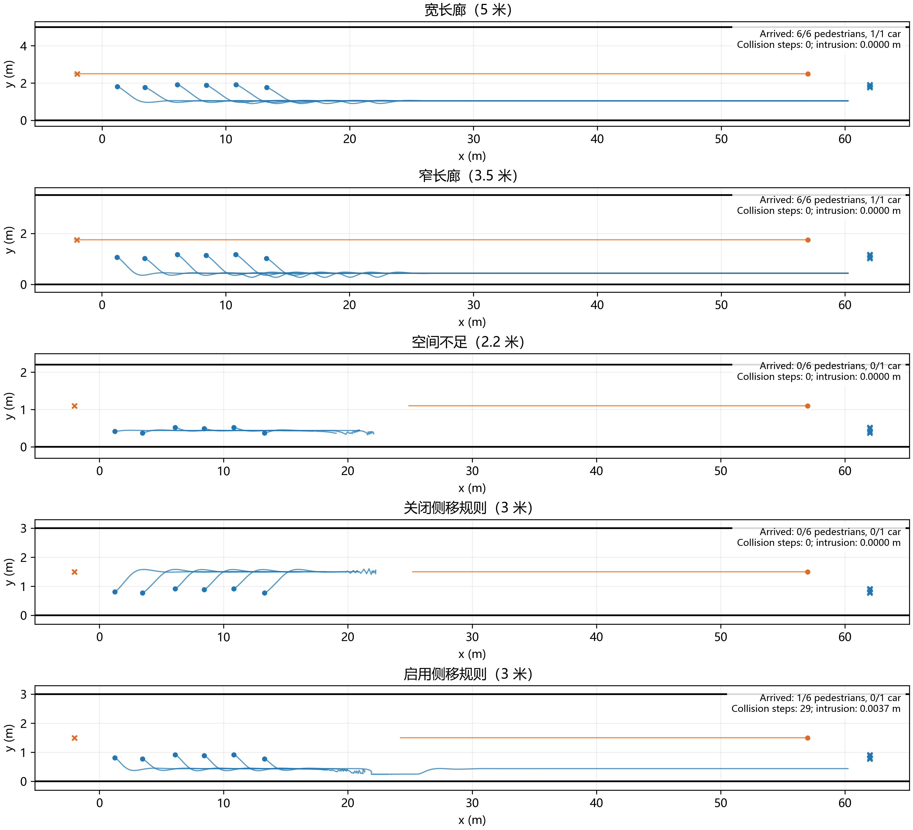
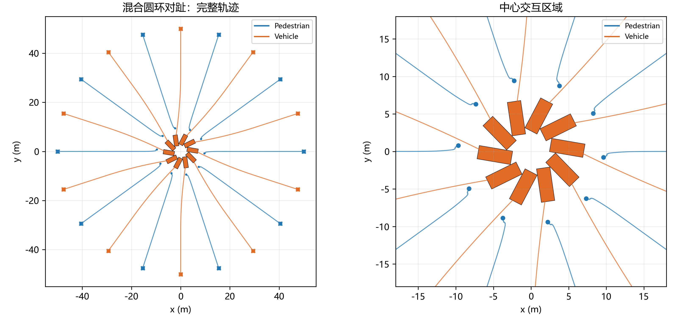
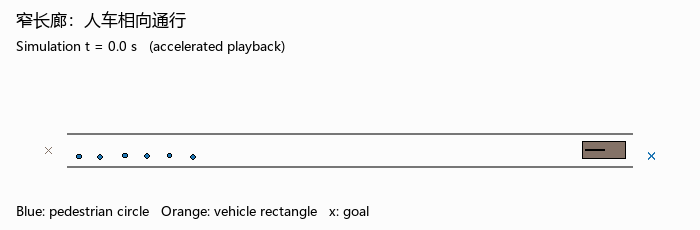
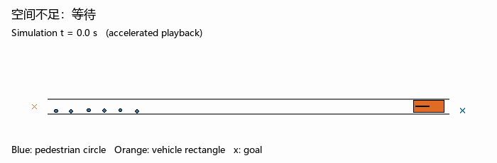
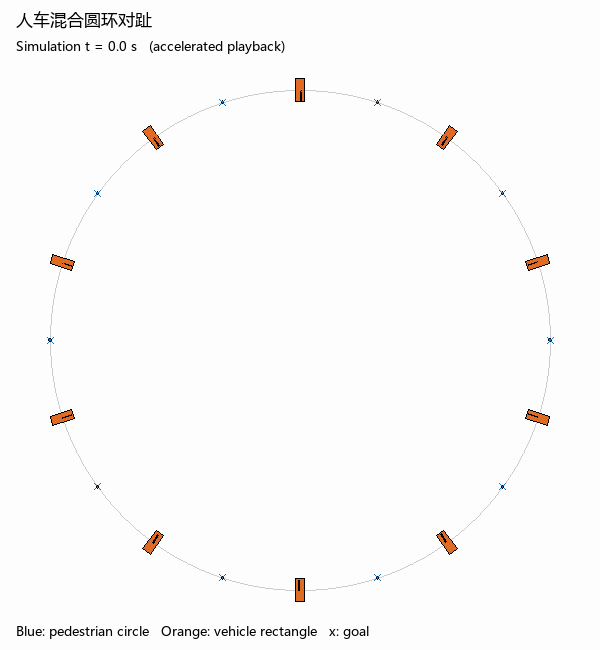

# 第六周：统一模型下的人车混行

采用统一社会力方程与显式让行规则。行人使用圆形碰撞体，车辆使用矩形碰撞体；两者共用运动驱动、主体排斥与边界作用框架，参数和车辆运动学约束按类型区分。本次固定参数直接运行，未进行参数搜索或标定。

## 实验结果

| 场景 | 行人到达 | 车辆到达 | 全部到达用时 / s | 碰撞步数 | 最大越界 / m |
|---|---:|---:|---:|---:|---:|
| 宽长廊（5 m） | 6/6 | 1/1 | 47.66 | 0 | 0.0000 |
| 窄长廊（3.5 m） | 6/6 | 1/1 | 47.82 | 0 | 0.0000 |
| 空间不足（2.2 m） | 0/6 | 0/1 | 未全部到达 | 0 | 0.0000 |
| 关闭侧移规则（3 m） | 0/6 | 0/1 | 未全部到达 | 0 | 0.0000 |
| 启用侧移规则（3 m） | 1/6 | 0/1 | 未全部到达 | 29 | 0.0037 |
| 人车混合圆环对趾 | 0/10 | 0/10 | 未全部到达 | 0 | 0.0000 |

仿真上限为 150 s，全部到达时提前结束；碰撞与越界按每个 0.01 s 积分步的状态检查。到达后主体退出场景，不再作为障碍或计入碰撞。碰撞步数指至少一对主体重叠的时间步数，不代表独立事故次数。

## 分析

较宽长廊与任务设定的窄长廊均能完成人车迎面通行，缩窄后通行余量减少。继续缩窄至无法容纳人车并排时，双方保持等待而没有穿越彼此。关闭侧移规则也会造成僵持，但恢复侧移并不意味着问题已经解决：在更窄的对照中，局部通行伴随碰撞和轻微越界，说明软排斥与侧移偏好不足以提供安全保证。混合圆环对趾实验中，各主体汇入中心后未能完成通行，体现了当前局部规则处理多方向冲突的局限；零碰撞不能被解释成模型成功。

## 动图

动图覆盖完整仿真时间，采用加速播放；画面时钟表示仿真时间。

## 代码与复现

模型和规则见 [unified_sfm.py](unified_sfm.py)，全部场景见 [run_all.py](run_all.py)，精确碰撞检查见 [evaluate.py](evaluate.py)。参数、选型依据与复现命令见 [README.md](README.md)。

## AI 辅助与核查

使用 AI 辅助恢复任务记录、检索模型依据、修正代码并绘图。核查发现旧版横向衰减误用了单位方向分量，加速度限幅被后续向量重构抵消，已分别改为实际距离与正确的平行/垂直分解。还修正了到达主体仍参与碰撞统计的问题，并以矩形角部碰撞、车辆不侧滑等回归检查验证。结果由实际仿真生成，保留失败结果，没有将失败包装为成功。
