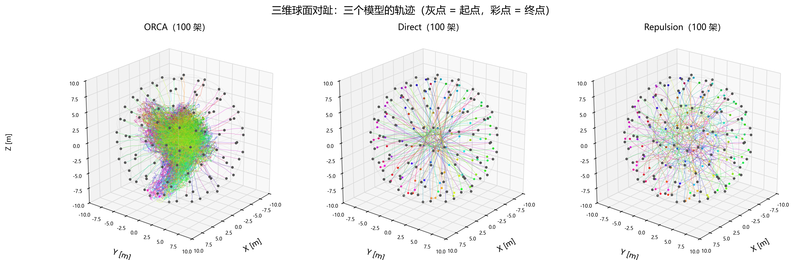
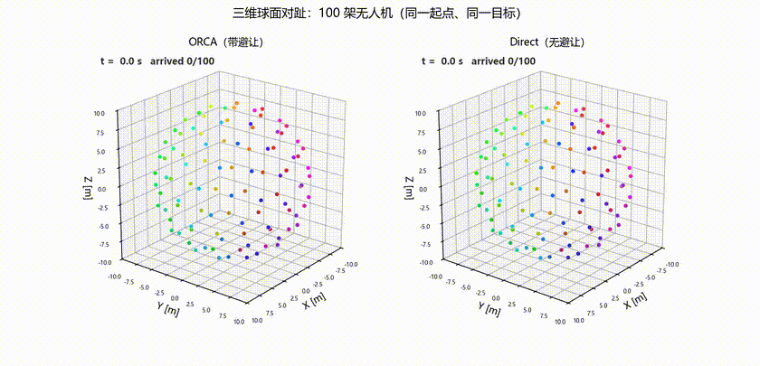
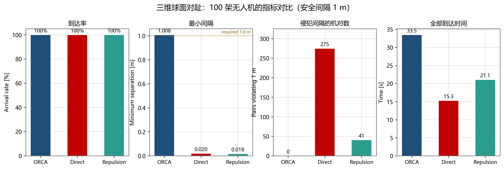
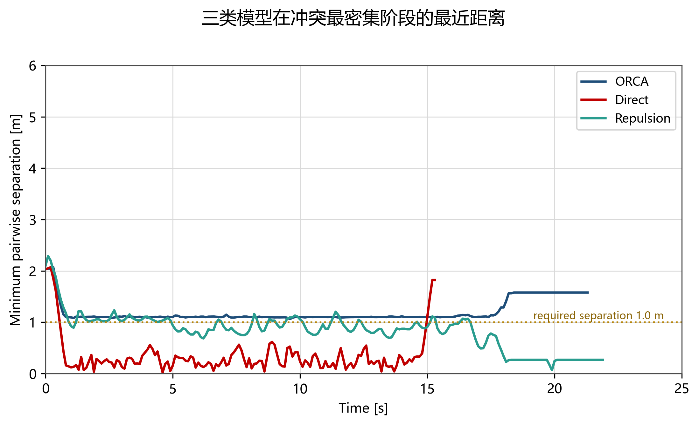

# week07 作业 —— 三维球面 100 机对趾冲突（ORCA）

## 1. 场景设定

100 架无人机被约束在一个球面上，**同时飞向各自的对趾点**（目标 = 起点的反向点）。
不考虑重力，无人机做全向移动，只受速度上限约束，属于**速度层**控制（不考虑加速度）。

| 参数 | 取值 | 说明 |
|---|---|---|
| 无人机数量 | 100 | **球面均匀分布**：Fibonacci 播种 + 排斥松弛（见下） |
| 球半径 | **10 m** | |
| 安全半径 | 0.5 m | 任意两机间隔 ≥ **1 m** |
| 最大速度 | 2 m/s | |
| 时间步长 | 0.1 s | |
| ORCA 时间窗 τ | 5 s | |
| 初速 | 0 | |
| 终止条件 | 距目标 ≤ 1 m 即停留 | 停留后视为静止障碍 |
| 更新方式 | 同步 | 先算完所有机的新速度再统一更新 |
| 限时 | 120 s | |

**对趾方向的简并**：球面上从 p 到 −p 的最短路径是任意一条过这两点的大圆，
方向**不唯一**——把 −p 投影到 p 的切平面上恰好得到零向量。
因此每架机需要一个初始切向来做对称性破缺，本实现取确定性随机切向（seed=0）。

### 起点均匀性

"均匀"不能靠肉眼。Fibonacci 分布只是**准**均匀：它有螺旋纹，最近邻距离的离散度不小。
本实现先 Fibonacci 播种，再做 **800 步球面排斥松弛**（两两 1/d² 斥力、投影到切平面、
归一化回球面），把间距压平。用最近邻距离的变异系数衡量：

| 分布 | 最近邻均值 [m] | 标准差 [m] | **变异系数** | 最小 [m] | 最大 [m] | max/min |
|---|---|---|---|---|---|---|
| Fibonacci | 3.312 | 0.279 | 8.44% | 2.010 | 3.447 | 1.71 |
| **松弛后** | **3.562** | **0.077** | **2.17%** | **3.431** | **3.740** | **1.09** |

100 点在 R = 10 m 球面上的理想六边形密排间距是 3.809 m；松弛后均值 3.562 m（约 93.5%），
差值来自球面无法铺满正六边形，属几何上限。所有点到球心的距离误差 |‖p‖ − R| ≤ 1.8×10⁻¹⁵ m，
终点严格取 p·goal = −R²（即关于球心对称）。

均匀化不只是"好看"：它去掉了原有分布里的偶然空隙，**冲突被摊得更开**，
因而整体更难通过（见 §5 的用时对比）。

## 2. 模型选型

上层算法用 **ORCA**（Optimal Reciprocal Collision Avoidance，van den Berg et al. 2011）。
选它的理由不是"流行"，而是它同时满足本场景的四个硬约束：

1. **速度层**：题目明确"暂不考虑加速度"，ORCA 正是直接输出速度，不需要再套一层动力学；
2. **互惠**：100 架机地位对等，ORCA 的"各承担一半避让"假设天然适配；
3. **可扩展到 100 个智能体**：每架机只解一个小规模线性规划，总代价 O(N·k)，实测 100 机 1200 步约 10 s；
4. **有明确的安全保证**：只要所有约束可行，就能保证 τ 内不发生碰撞——这给"失败"提供了一个可检验的判据。

对比模型（同一场景、同一初值）：

| 模型 | 做法 | 作用 |
|---|---|---|
| **ORCA** | 球面切平面上的半平面约束 + 线性规划 | 主模型 |
| **Direct** | 直接朝目标飞，不做任何避让 | 下界基线：说明"不避让会怎样" |
| **Repulsion** | 在期望速度上叠加邻居的指数排斥 | 上界对照：说明"只靠排斥场够不够" |

## 3. 球面 ORCA 的实现要点

ORCA 原本是平面上的方法，搬到球面上需要三步（`orca3d.py`）：

1. 在无人机位置 p 取切平面，构造正交基 (e₁, e₂)，法向 n = p/|p|；
2. 把邻居的相对位置、相对速度投影到切平面，得到一个标准 2D ORCA 问题；
3. 解出的速度再映射回三维，沿速度积分后把位置归一化回球面（等效沿测地线走）。

投影误差量级为 d²/(2R)：本场景 d ≤ 1 m、R = 10 m 时约 **5 cm**，但方向是"把距离算小"，
即 ORCA 认为两机比实际更近，属于**保守**误差，不会因此漏判。

四个实现层面的关键处理（都是踩过坑之后加的）：

| 处理 | 原因 |
|---|---|
| **TTC 预筛邻居**（`could_collide`） | 只有 τ 内可能相撞的邻居才生成半平面。否则 100 机时每步要解 99 条约束，线性规划退化成 O(N²) |
| **静止邻居承担全部责任**（`share=1.0`） | 已到达停住的无人机不会让路，若仍按"各让一半"处理，运动方只避一半 → 实测有 1 架永远到不了 |
| **碰撞后 1/Δt 截断圆** | 已经重叠时用 τ 锥会解不出可行速度，改用 1/Δt 把两机强行推开（RVO2 的做法） |
| **5 cm 安全余量** | 理论上 ORCA 恰好保证 1.0 m，但离散时间步、切平面投影、偶发 LP 不可行会吃掉几毫米。约束半径取 0.55 m，**评价口径仍是 1.0 m** |

## 4. 结果

### 4.1 三维轨迹与动画

下面的轨迹图使用固定的无人机颜色：颜色由起始球面区域决定，同一架无人机在整个仿真过程中保持同色；轨迹线显示其在三维空间中的历史运动。



动画对比了 ORCA 和 Direct 两种模型。左侧是带避让的三维 ORCA，右侧是直接飞向对趾点的基线；每架无人机均显示为独立颜色，并保留运动轨迹。



[下载 MP4 原视频](results/sphere_orca_vs_direct.mp4)





**指标对比表**（100 架，R = 10 m，限时 120 s）：

| 模型 | 到达率 | 最小间隔 [m] | 侵犯 1 m 的机对数 | 全部到达时间 [s] | 平均累计路程 [m] |
|---|---|---|---|---|---|
| **ORCA** | **100/100** | **1.008** | **0 / 4950** | 33.5 | 31.11 ± 1.20 |
| Direct | 100/100 | 0.020 | 275 / 4950 | 15.3 | 30.60 ± 0.00 |
| Repulsion | 100/100 | 0.018 | 41 / 4950 | 21.1 | 31.99 ± 0.57 |

**安全余量的 A/B 对照**（同一均匀分布、只改 ORCA 约束半径）：

| ORCA 约束半径 | 最小间隔 [m] | 侵犯 1 m 的机对数 | 全部到达 [s] | 平均路程 [m] |
|---|---|---|---|---|
| 0.50 m（无余量） | 0.852 | 30 | 22.3 | 30.76 |
| **0.55 m（+5 cm）** | **1.008** | **0** | 33.5 | 31.11 |

动画：`results/sphere_orca_vs_direct.mp4`（左 ORCA，右 Direct，20 fps）。

## 5. 分析

三个模型都能在限时内全部到达，差别不在"能不能到"，而在**到达的代价**。

Direct 最快，因为它根本不看别人：每架机沿自己那条测地线全速前进，路程恰好等于半个大圆，
所以路程的标准差是零——所有人走的是同一条长度。代价是最小间隔被压到 2 cm 量级，
4950 个机对里有 275 对在某个时刻贴到了一米以内。这组数字的意义是给出一个**几何基准**：
在没有避让的情况下，这个场景本身有多少冲突是"必然发生"的。

Repulsion 用指数排斥替代了速度障碍推理，把违规机对数从 275 压到 41，
但最小间隔仍然只有 0.018 m——比 Direct 的 0.020 m 还略低一点。
这很说明问题：排斥场是**连续、软性**的作用，两机高速对冲时排斥力上升得太晚，
它能把"迎面对撞"改成"擦身而过"，却不能在运动学上封死一条不可穿越的边界；
而且均匀分布把偶然空隙抹掉之后，它连"侥幸穿过"的机会也没有了。

ORCA 是唯一把最小间隔守在 1 m 以上的模型——这不是调参调出来的，而是半平面约束的构造使然：
每架机在速度空间里划掉一个凸区域，只要线性规划有解，未来 τ 秒内就撞不上。
代价是它慢了不止一点：33.5 s，是直接飞行的两倍多，平均路程也多了 0.5 m。

这个"两倍多"值得解释。ORCA 的绕行只增加了约 1.7% 的路程，时间却翻倍，
说明主要代价不是**绕远**而是**减速与等待**——在均匀分布下，每架机的邻域里都有
八个距离相近的邻居，冲突是"处处都有"而不是"集中在几条对撞带"。
对照之前用 Fibonacci 布局（最近邻变异系数 8.4%、最小间距只有 2.0 m）时 ORCA 只用 21.3 s，
可见**均匀化反而让场景更难**：它抹掉了那些可以被利用的空隙。

ORCA 的路程标准差是 1.20 m，而 Direct 是 0，说明负担仍然不均匀——处在冲突核心的
无人机绕得更多。但和旧的 Fibonacci 布局相比，这个离散度并没有变小，
只是"谁被堵"从固定变成了随机的：均匀分布消除了系统性偏差，但没有消除排队。

从安全余量的 A/B 对照还能看到一个更尖锐的取舍：把约束半径从 0.50 m 加到 0.55 m，
违规机对数从 30 降到 0，但全部到达时间从 22.3 s 涨到 33.5 s。
5 cm 的余量换来 50% 的时间代价，说明这个场景已经相当接近通行能力的临界点——
在这种密度下，安全与效率不是可以同时优化的两个独立目标。

## 6. 失败解释

**第一版的问题是"有一架永远到不了"。** 100 架里 99 架在 20 s 内到达，剩下 1 架在目标附近
来回打转直到 120 s 超时。

排查过程：把到达标记和速度打印出来后发现，这架机卡在**已经停住的其他无人机**之间。
根因是 ORCA 的互惠假设——它假设双方各承担一半避让责任。但已到达的无人机速度恒为 0，
它**不可能履行**那一半责任；于是运动方只让了一半，剩下的一半没人让，
就形成了"以为自己能过、实际过不去"的僵局。

修改：把静止邻居单独标记，构造半平面时用 `share = 1.0`（全部责任由运动方承担），
相当于把它当成静态障碍物。修改后 100/100 全部到达。

**第二版的残余问题是"最小间隔压到 1 m 以下"。** 修好死锁之后，在同一套均匀分布上
把 ORCA 的约束半径就取成理论值 0.50 m，最小间隔只有 **0.852 m**，30 个机对越界——
而全部到达时间只要 22.3 s。也就是说，它"快"是拿安全换的。
根因有三层：离散时间步（Δt = 0.1 s，2 m/s 下每步位移 0.2 m）、切平面投影的近似、
以及局部密度过高时线性规划**可行域为空**、只能返回近似解。
把约束半径放大到 0.55 m 后，违规机对数降到 0、最小间隔 1.008 m，但全部到达时间涨到 33.5 s。
这个 A/B 对照说明："ORCA 保证安全"并不是无条件成立的，它需要给数值误差留出显式余量。

这个失败案例说明一件事：**ORCA 的安全保证是有条件的**——它要求约束集完整、
可行域非空、且所有 agent 都按互惠假设行动。一旦有 agent 因为到达而"退出博弈"，
或者局部密度导致可行域为空，保证就会退化。工程上必须靠"静止障碍全责 + 安全余量"
这两条补丁把边界情况兜住。

## 7. 复现

```bash
# 环境：D:\Users\xsxsyyds\miniconda3\envs\study\python.exe（numpy / matplotlib / imageio-ffmpeg）
python sim_sphere.py                 # 三个模型，输出轨迹 npz + 指标 csv/json
python plot_results.py               # 三张 PNG
python make_video.py                 # results/sphere_orca_vs_direct.mp4
```

`sim_sphere.py` 支持改规模：`--n 100 --radius 10 --t-end 120 --models orca`。

## 8. 说明

- **AI 辅助内容**：球面 ORCA 的实现、仿真、指标统计、绘图与视频均由 AI 辅助完成。
  线性规划部分对照 RVO2 参考实现逐函数移植。
- **本人完成的检查**：
  - 核对 ORCA 半平面构造的符号与 `u` 的方向（对照 van den Berg 2011 式 5–7）；
  - 确认切平面投影的误差量级 d²/(2R) 远小于安全间隔；
  - 逐条核对三项指标的定义与统计口径（最小间隔按全部 4950 个机对、逐帧取最小）；
  - 复现"到达即停"导致的死锁，并验证 `share=1.0` 修复前后的到达率变化。
- **局限**：
  1. 球半径 10 m 是自选值，题目未指定；改半径会改变面密度，指标不可直接跨半径比较；
  2. "距目标 ≤ 1 m 即停留"是瞬时停车，等价于无穷大减速度，与"不考虑加速度"的设定一致，
     但会让到达点附近出现速度突变；
  3. ORCA 的保证依赖邻居完整与可行域非空，本实现用 5 cm 余量兜底，属于工程处理而非理论保证；
  4. 未考虑无人机姿态、转弯半径与风扰。
